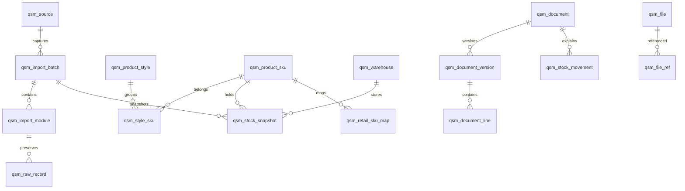

# 七色米 SQL Server 表结构设计审阅稿

日期：2026-10-19。状态：**界面已获用户确认；本表结构待确认，尚未建表、导入或实现接口。**

用户要求每张表都有删除标志。本稿共设计 **37 张 `dbo.qsm_*` 表**，包括采集批次、原始记录、关联表和审计表，全部使用 `valid bit NOT NULL DEFAULT 1`：`1` 有效，`0` 逻辑删除。现有零售表不在本次改表范围内。

## 1. 主要选择

- **款式与尺码分开**：款式 → SKU → 各仓库存。SKU 保留七色米 `ProductId`；同款归组由独立关系维护，支持规则归组、人工确认和纠错。
- **完整保留来源**：61 份业务 JSONL、20 份平台原表工作表、媒体索引及核对资料都有保存位置。查询常用字段结构化；其余完整字段保存在原始 JSON 中，不因统一表结构而丢弃。
- **单据统一、类型分开**：采购、销售、调拨等共享单据身份、版本和商品行，业务类型区分；收付款分账、核销另外保存。历史版本不重复累计到当前业务。
- **库存按成功批次发布**：总库存、各仓库存和库存流水保留批次。查询显示采集时间；导入失败不切换当前数据。
- **保留未来零售关联**：预留 SKU、门店仓库、零售明细与七色米单据的映射。先做只读查询和导入，后续另行确定扣库存及双向同步流程。

本稿依据本机已有导出结构、已确认原型、现有 `Product` / `Retail` / `Shop` 模型及 Fnb v4 的逻辑删除映射核对。没有连接生产数据库。原型示例数量不作为导入数据。

## 2. 数据核对对结构的影响

1. 已有商品的 `MainProductId` 全为空，不能直接当作款式父 ID。品牌、型号、款号、尺码等需要按分类识别，不能对全部商品固定把 `Property3` 解释成尺码。
2. 销售单号存在重复。单据唯一身份使用 **数据源 + 业务类型 + 来源业务 ID**，单号只建普通索引；原表如果只有单号，存在歧义时不自动关联。
3. 库存流水的 `IOId` 大部分为空，且存在完全相同的来源行。保存整批行号、内容哈希和重复序号；不把 `IOId` 或内容哈希单独设为全局唯一键，也不擅自删掉重复行。
4. 各仓采集省略账面数量为零的商品行。只有该批次对应仓库完整采集成功，才能把缺失组合的 **账面数量** 解释为零；不能顺便把缺失的金额、占用量等字段也补零。
5. 商品、往来单位、员工、仓库等存在停用或上游删除状态；单据还存在红冲、草稿、历史记录。以上与本地 `valid=0` 分开保存。
6. 销售商品明细报表同时包含销售和销售退货。当前来源 `BusiType=3/4` 分别指向销售/销售退货，报表中的 `SaleId` 不能一律解释成销售单 ID；关联必须结合来源业务类型。
7. 来源业务日期、来源创建时间和采集时间含义不同，可能存在异常日期。原值保留，异常进入核对列表，不按预设年份过滤。

## 3. 通用字段与约束

下文 `?` 表示允许 NULL；未标 `?` 的字段必须有值。未给默认值的必填字段由导入器或业务服务提供。`FK` 均采用 `NO ACTION`，不进行物理级联删除。

### C：所有 37 张表必备

| 字段 | SQL 类型 / 默认值 | 含义 |
| --- | --- | --- |
| `id` | `bigint IDENTITY(1,1)`，PK | 本地身份；API 以字符串返回，避免 JavaScript 整数精度损失 |
| `valid` | `bit NOT NULL DEFAULT 1` | 逻辑删除标志；0 表示删除 |
| `created_at` | `datetime2(3) DEFAULT SYSUTCDATETIME()` | 本地创建时间，UTC |
| `updated_at` | `datetime2(3) DEFAULT SYSUTCDATETIME()` | 本地更新时间，更新操作必须刷新 |
| `created_by`、`updated_by` | `nvarchar(128)?` | 导入任务或员工操作身份，不存登录凭据 |
| `deleted_at` | `datetime2(3)?` | 本地逻辑删除时间，UTC |
| `deleted_by` | `nvarchar(128)?` | 删除操作者，例如既有员工 ID 对应的操作身份 |
| `delete_reason` | `nvarchar(500)?` | 删除原因 |
| `row_version` | `rowversion` | 乐观并发校验；不是业务时间 |

删除约束：`valid=1` 时三个删除字段均为 NULL；`valid=0` 时三个字段均必须有值，原因不得为空。恢复操作清空删除字段，完整删除与恢复历史仍保存在 `qsm_change_log`。

### M：来源档案的附加字段

使用 M 的表同时包含 C，另外包含以下字段。表中的“字段”仅列自身附加字段。

| 字段 | 类型 | 含义 |
| --- | --- | --- |
| `source_id` | `bigint FK qsm_source` | 公司 / 账套数据源 |
| `source_key` | `nvarchar(128)` | 来源业务 ID；GUID 格式统一，不更改非 GUID ID 的大小写含义 |
| `last_seen_batch_id` | `bigint? FK qsm_import_batch` | 最近实际见到该记录的成功发布批次 |
| `last_raw_record_id` | `bigint? FK qsm_raw_record` | 最近发布的来源记录，指向完整字段 |
| `source_deleted` | `bit?` | 来源 `IsDel` 等明确删除标志；未知为 NULL |
| `source_enabled` | `bit?` | 来源启停状态，未知为 NULL |
| `source_state` | `nvarchar(100)?` | 来源状态码或原文，不强行把不同类型的状态码合并 |
| `source_missing` | `bit DEFAULT 0` | 后续完整同口径采集中未出现；不等于本地删除 |
| `is_stub` | `bit DEFAULT 0` | 来源 ID 可知但完整档案未取得的占位记录 |
| `source_created_at`、`source_updated_at` | `datetime2(3)?` | 能确定语义和时区时转换为 UTC；原始文本保留于 JSON |

M 的来源唯一键通常为 `(source_id, source_key)`，**覆盖 `valid=0` 的记录**；分类、往来单位、单据按下文额外加类型。重复导入更新同一身份，不因为逻辑删除再生出一个新身份；普通导入不能自动恢复本地删除。

### P：按批次保存的查询记录

使用 P 的表包含 C，以及 `source_id bigint FK qsm_source`、`batch_id bigint FK qsm_import_batch`、`raw_record_id bigint FK qsm_raw_record`、`json_path nvarchar(512) DEFAULT N'$'`。原始行含多个子项时，路径记录子项位置。

### 类型和关联规则

- 文本使用 `nvarchar`；编号、条码、尺码均按文本保存，保留前导零。来源 ID 使用 `Latin1_General_100_BIN2` 比较，GUID 在入库前统一为小写标准形式；名称及搜索文本使用现有源码采用的 `Chinese_PRC_CI_AS` 比较口径。
- 数量、单价、金额使用 `decimal(19,6)`；单位比率、汇率用 `decimal(19,9)`。不使用 `float` / `double` 参与核对。超精度不得静默截断，原值保留并报告差异。
- 金额和数量允许负数，不能统一设置“大于等于零”。单位换算比率必须大于零；换算不了时保留输入量，基础单位数量为 NULL 并报告。
- 业务发生时间使用 `datetime2(3)` 保存来源当地时间，并由数据源注明时区；采集、导入、审计时间为 UTC。来源只提供日期时另存精度标记 `date`，不能假装有精确时刻。
- JSON 使用 `nvarchar(max)`，设置 `ISJSON` 检查；来源 JSON 在入库前移除登录凭据、会话令牌及下载地址中的认证参数。业务字段原名、值、NULL、数组和中文原表列名保留，原文件校验值另存。
- 七色米表之间的外键必须指向同一 `source_id`，数据源自身以 `id` 为根键。第三阶段 DDL 使用父表 `(source_id,id)` 候选键及复合外键落实；批次、原始记录也检查同源同批。本站 `product/retail/shop_list` 外键仍按其现有主键关联，由映射服务验证业务归属。可空的多目标引用另设 CHECK。不能仅靠猜测名称填外键。
- 下列审阅稿不是可执行迁移脚本；索引和 CHECK 在表结构获确认后生成并实际验证。

## 4. 表清单与关系

| 组 | 表 |
| --- | --- |
| 数据源与导入（4） | `qsm_source`、`qsm_import_batch`、`qsm_import_module`、`qsm_raw_record` |
| 档案与款式（15） | `qsm_category`、`qsm_unit`、`qsm_branch`、`qsm_warehouse`、`qsm_warehouse_position`、`qsm_product_style`、`qsm_product_sku`、`qsm_style_sku`、`qsm_sku_attribute`、`qsm_sku_unit`、`qsm_partner`、`qsm_account`、`qsm_employee`、`qsm_role`、`qsm_project` |
| 单据与明细（6） | `qsm_document`、`qsm_document_version`、`qsm_document_line`、`qsm_document_relation`、`qsm_settlement_line`、`qsm_writeoff_line` |
| 库存与销售报表（4） | `qsm_stock_total`、`qsm_stock_snapshot`、`qsm_stock_movement`、`qsm_sales_report_line` |
| 文件与原表（3） | `qsm_file`、`qsm_file_ref`、`qsm_export_sheet` |
| 零售映射（3） | `qsm_retail_sku_map`、`qsm_retail_warehouse_map`、`qsm_retail_sale_link` |
| 核对与审计（2） | `qsm_data_issue`、`qsm_change_log` |

上图只画主要关系；每张表仍独立具有 C 删除字段，原始记录到查询表的具体追溯见各表。

## 5. 数据源与导入

### 01. `dbo.qsm_source` — 公司 / 账套

**C**。字段：

| 字段 | 类型 | 说明 |
| --- | --- | --- |
| `platform_code` | `varchar(32) DEFAULT 'qisemi'` | 平台标识 |
| `company_key`、`book_key` | `nvarchar(128)` | 来源公司与账套 ID；不得用登录手机号代替 |
| `display_name` | `nvarchar(200)` | 数据源展示名 |
| `source_timezone` | `nvarchar(64) DEFAULT N'Asia/Shanghai'` | 解释来源业务时间 |
| `current_full_batch_id` | `bigint? FK qsm_import_batch` | 当前全业务批次 |
| `current_inventory_batch_id` | `bigint? FK qsm_import_batch` | 当前库存批次；可以比全业务批次更新 |

唯一键：`(platform_code,company_key,book_key)`，含删除记录。批次指针只能指向同源、有效、已发布且核对通过的相应范围批次。初次发布之前为 NULL。

### 02. `dbo.qsm_import_batch` — 一次采集结果的导入

**C**。字段：`source_id bigint FK`；`batch_key uniqueidentifier`；`scope varchar(16)`（`full` / `inventory`）；`dataset_hash binary(32)`；`parser_version nvarchar(64)`；`capture_started_at/capture_finished_at datetime2(3)`；`import_started_at/import_finished_at/published_at datetime2(3)?`；`state varchar(20)`；`verification_passed bit DEFAULT 0`；`package_file_id bigint? FK qsm_file`；`manifest_json/verification_json nvarchar(max)`；`error_summary nvarchar(2000)?`。

唯一键：`batch_key`，以及 `(source_id,dataset_hash,parser_version)`，均含删除记录。`dataset_hash` 由规范化文件清单与内容校验值计算，排除机器绝对路径及打包时间；原 ZIP 字节哈希属于文件表。同批重试复用身份；换解析器重处理另建批次，仍保留原批。

状态：`staging → validated → published`，或 `failed` / `revoked`。只允许已验证完整范围发布。撤回必须同时处理当前指针，不能只隐藏批次而保留指针。

### 03. `dbo.qsm_import_module` — 模块范围与完成度

**C**。字段：`source_id bigint FK`；`batch_id bigint FK`；`module_key nvarchar(128)`；`carrier varchar(24)`（`api` / `native_sheet` / `media` / `metadata`）；`state varchar(20)`（`complete` / `empty` / `failed` / `omitted`）；`expected_count/actual_count bigint?`；`file_hash binary(32)?`；`capture_started_at/capture_finished_at datetime2(3)?`；`coverage_json nvarchar(max)`；`error_summary nvarchar(2000)?`。

唯一键：`(batch_id,module_key,carrier)`。`coverage_json` 保留日期/状态范围、分页完成情况、零行省略语义、逐仓成功范围、原表工作表信息。空模块必须有 `empty` 行；未采集不能冒充空。索引 `(source_id,batch_id,state)`。

### 04. `dbo.qsm_raw_record` — 完整原始记录

**C**。字段：`source_id bigint FK`；`batch_id bigint FK`；`module_id bigint FK qsm_import_module`；`row_ordinal bigint`；`source_entity_key nvarchar(200)?`；`parent_source_key nvarchar(200)?`；`payload_json nvarchar(max)`；`payload_hash binary(32)`；`duplicate_ordinal int DEFAULT 1`；`sheet_id bigint? FK qsm_export_sheet`。

唯一键：`(module_id,row_ordinal)`。索引 `(module_id,source_entity_key)`、`(module_id,payload_hash,duplicate_ordinal)`。保留重复行及顺序；不对 `payload_hash` 单独唯一。原始内容导入后不覆盖，只有 C 中的逻辑删除元数据可经审计调整。

61 份业务来源分别登记模块，20 份原表工作表分别登记模块；媒体索引和 manifest / verification / 状态资料亦登记。凭据、会话与采集分页缓存不属于业务原始记录。

## 6. 档案与同款归组

### 05. `dbo.qsm_category` — 商品 / 客户 / 供应商分类

**M**。字段：`category_kind varchar(24)`（`product/client/supplier`）；`parent_id bigint? FK self`；`branch_id bigint? FK qsm_branch`；`name nvarchar(300)`；`sort int DEFAULT 100`；`path_text nvarchar(2000)?`。

来源唯一键：`(source_id,category_kind,source_key)`。父子分类必须同源同类型，禁止环；索引 `(source_id,category_kind,parent_id,valid,sort)`。根节点与完整分类树按同一来源 ID 合并，不能重复建分类。

### 06. `dbo.qsm_unit` — 计量单位

**M**。字段：`name nvarchar(100)`；`allows_decimal bit?`；`remark nvarchar(1000)?`。索引 `(source_id,name)`。单位名称不唯一，不按同名自动合并来源 ID。

### 07. `dbo.qsm_branch` — 来源门店 / 分支

**M**。字段：`parent_id bigint? FK self`；`code nvarchar(100)?`；`name nvarchar(200)`；`address nvarchar(1000)?`；`telephone nvarchar(100)?`；`branch_type nvarchar(40)?`。索引 `(source_id,parent_id,valid)`、`(source_id,code)`。

### 08. `dbo.qsm_warehouse` — 仓库

**M**。字段：`branch_id bigint? FK qsm_branch`；`code nvarchar(100)?`；`name nvarchar(200)`；`source_warehouse_type nvarchar(40)?`；`warehouse_purpose varchar(24) DEFAULT 'unreviewed'`；`retail_use varchar(16) DEFAULT 'unreviewed'`；`sort int DEFAULT 100`。

`warehouse_purpose`：`unreviewed/retail/transit/check/problem/other`，人工确认；`retail_use`：`unreviewed/allow/exclude`。初次导入不按名称推断可售，不把问题仓账面量排除出默认账面查询。索引 `(source_id,branch_id,valid,sort)`。

### 09. `dbo.qsm_warehouse_position` — 仓位

**M**。字段：`warehouse_id bigint FK qsm_warehouse`；`code nvarchar(100)?`；`name nvarchar(200)`。索引 `(source_id,warehouse_id,valid)`。来源目前为空，先保留结构；实际来源 ID / 父仓字段未验证时不得凭名称补出仓位。

### 10. `dbo.qsm_product_style` — 跨尺码的款式

**C**。字段：`source_id bigint FK`；`style_key uniqueidentifier`；`display_name nvarchar(300)`；`brand nvarchar(100)?`；`model nvarchar(300)?`；`style_code nvarchar(100)?`；`season/color/gender nvarchar(100)?`；`flex_label nvarchar(100)?`；`category_id bigint? FK qsm_category`；`base_unit_id bigint? FK qsm_unit`；`group_signature binary(32)?`；`group_method varchar(16)`（`rule/manual/singleton`）；`rule_version nvarchar(64)?`；`review_state varchar(16) DEFAULT 'pending'`；`search_text nvarchar(2000)`。

唯一键：`(source_id,style_key)`，含删除记录。`group_signature` 仅普通索引，不把自动推断的签名视为绝对唯一。支持 `pending/confirmed/conflict`；字段不足先建独立款式。归组规则、拆分/合并由审计记录，不更改 SKU 身份或既有库存。

### 11. `dbo.qsm_product_sku` — 来源商品 / 尺码 SKU

**M**。字段：`record_kind varchar(24) DEFAULT 'product'`；`code/barcode nvarchar(200)?`；`name nvarchar(300)`；`category_id bigint? FK qsm_category`；`base_unit_id bigint? FK qsm_unit`；`source_main_product_key nvarchar(128)?`；`season nvarchar(100)?`；`size_label nvarchar(100)?`；`size_sort decimal(9,3)?`；`shelf_state nvarchar(40)?`；`remark nvarchar(2000)?`；`search_text nvarchar(2000)`。

`source_key` 来自 `ProductId`。来源唯一键不包含编号/条码；编号、条码仅普通索引，不能假定未来永远唯一。`size_label` 保存 `26.5`、`M`、`均码` 等原文，`size_sort` 仅辅助排序。配件有可靠商品身份时 `record_kind='accessory'`，没有可靠关联时先保存在原始模块，不伪造普通商品。

### 12. `dbo.qsm_style_sku` — 款式归组关系

**C**。字段：`source_id bigint FK`；`style_id bigint FK qsm_product_style`；`sku_id bigint FK qsm_product_sku`；`assignment_method varchar(16)`（`rule/manual/singleton`）；`rule_version nvarchar(64)?`；`confirmed_by nvarchar(128)?`；`confirmed_at datetime2(3)?`；`locked bit DEFAULT 0`；`evidence_json nvarchar(max)`。

筛选唯一键：`(source_id,sku_id) WHERE valid=1`，一个 SKU 当前只属于一个款式。索引 `(source_id,style_id,valid)`。换组事务内删除旧关系、增加新关系并审计；人工锁定的关系不被下次规则覆盖。

### 13. `dbo.qsm_sku_attribute` — 商品属性

**C**。字段：`source_id bigint FK`；`sku_id bigint FK qsm_product_sku`；`attribute_key nvarchar(128)`；`source_label nvarchar(200)?`；`semantic_key varchar(32)?`；`value_text nvarchar(2000)?`；`value_json nvarchar(max)?`；`sort int DEFAULT 100`；`last_seen_batch_id bigint FK`；`last_raw_record_id bigint FK`；`json_path nvarchar(512)`。

唯一键：`(sku_id,attribute_key)`，含删除记录。保存 `Property1..5`、自定义 `FieldList` 等；`semantic_key` 由分类规则解释为 `brand/model/style_code/size/color/gender/flex` 等，未确定就为 NULL。`value_text` 与 `value_json` 至少一个非 NULL。属性解释不覆盖原名和原值。

### 14. `dbo.qsm_sku_unit` — 商品单位、换算与参考价

**C**。字段：`source_id bigint FK`；`sku_id bigint FK qsm_product_sku`；`unit_id bigint FK qsm_unit`；`source_unit_row_key nvarchar(128)?`；`ratio_to_base decimal(19,9)`；`is_base bit`；`allows_decimal bit?`；`barcode nvarchar(200)?`；`sale_price/buy_price/lower_price decimal(19,6)?`；`price_tiers_json nvarchar(max)?`；`last_seen_batch_id bigint FK`；`last_raw_record_id bigint FK`；`json_path nvarchar(512)`。

唯一键：`(sku_id,unit_id)`，含删除记录；有效基础单位筛选唯一键 `(sku_id) WHERE valid=1 AND is_base=1`。比率 > 0，基础单位比率 = 1。缺少或冲突的基础单位报告阻断，不猜换算。档案价格不追改历史单据行。

### 15. `dbo.qsm_partner` — 客户 / 供应商

**M**。字段：`partner_kind varchar(16)`（`client/supplier`）；`code nvarchar(100)?`；`name nvarchar(300)`；`category_id bigint? FK qsm_category`；`branch_id bigint? FK qsm_branch`；`contact_name nvarchar(200)?`；`telephone nvarchar(100)?`；`address nvarchar(1000)?`；`email nvarchar(200)?`；`remark nvarchar(2000)?`；`receivable/payable/stored_amount/points decimal(19,6)?`。

唯一键：`(source_id,partner_kind,source_key)`。同一公司既为客户又为供应商时保留两个来源身份，不按名称合并。余额和积分是最近来源值，原始字段和时间仍可追溯；不能通过复制此表直接生成本站会员资产。

### 16. `dbo.qsm_account` — 来源结算账户

**M**。字段：`branch_id bigint? FK qsm_branch`；`name nvarchar(200)`；`short_name nvarchar(100)?`；`account_type nvarchar(100)?`；`account_number nvarchar(200)?`；`bank_account_name nvarchar(200)?`；`initial_amount/current_amount decimal(19,6)?`；`remark nvarchar(2000)?`。索引 `(source_id,branch_id,valid)`。账户资料与成本类字段需后端按既有员工权限控制，前端隐藏不是权限控制。

### 17. `dbo.qsm_employee` — 来源员工

**M**。字段：`branch_id bigint? FK qsm_branch`；`name nvarchar(200)`；`login_name nvarchar(200)?`；`telephone nvarchar(100)?`；`user_type/user_status nvarchar(40)?`；`is_root bit?`。

来源员工仅用于业务展示、经手人关联；不自动创建本站员工或登录权限，不保存密码和会话。

### 18. `dbo.qsm_role` — 来源角色

**M**。字段：`name nvarchar(200)`；`permission_json nvarchar(max)?`；`remark nvarchar(2000)?`。来源角色权限只读展示，不替代本站企业微信鉴权；未抓取到的员工角色分配不凭空生成关系。

### 19. `dbo.qsm_project` — 来源收支项目

**M**。字段：`parent_id bigint? FK self`；`name nvarchar(200)`；`direction varchar(16)?`（`income/expense/other`）；`remark nvarchar(2000)?`。索引 `(source_id,parent_id,valid)`。方向不明时为 NULL，原值保留。

## 7. 单据、版本和关联

### 20. `dbo.qsm_document` — 单据稳定身份

**M**。字段：`document_type varchar(40)`；`document_no nvarchar(200)?`；`current_version_id bigint? FK qsm_document_version`；`listing_state varchar(24)`（`current/history_only/missing_source`）。

唯一键：`(source_id,document_type,source_key)`，含删除记录。索引 `(source_id,document_type,document_no)`，**不唯一**。`current_version_id` 必须属于本单据、同源且有效；来源没有当前列表版本时，可指向最近已取得的历史详情，同时 `listing_state='history_only'`，不进入当前业务合计。

业务类型：`purchase/purchase_return/purchase_order/sale/sale_return/sale_order/sale_draft/transfer/stocktake/loan_in/loan_out/loan_in_return/loan_out_return/inbound/outbound/other_inbound/other_outbound/assembly/cost_adjustment/receipt/payment/income_expense/account_transfer/writeoff/client_stored_order/client_stored_movement/client_points`。

### 21. `dbo.qsm_document_version` — 一次采集中的单据内容

**P**。字段：

| 字段 | 类型 | 说明 |
| --- | --- | --- |
| `document_id` | `bigint FK qsm_document` | 稳定身份 |
| `revision_key` | `binary(32)` | 来源修订标记及所选内容的规范化哈希 |
| `version_kind` | `varchar(16)` | `current/historical`，不等于红冲状态 |
| `document_no` | `nvarchar(200)?` | 该版本单号快照 |
| `business_at` | `datetime2(3)?` | 来源当地业务时间 |
| `business_time_precision` | `varchar(16) DEFAULT 'unknown'` | `date/datetime/unknown` |
| `branch_id`、`partner_id` | `bigint? FK` | 解析确定的门店和客户/供应商 |
| `warehouse_id`、`from_warehouse_id`、`to_warehouse_id` | `bigint? FK qsm_warehouse` | 普通、调出、调入仓；多仓以商品行或关联为准 |
| `business_employee_id`、`creator_employee_id` | `bigint? FK qsm_employee` | 来源经手人和制单人 |
| `branch_name/partner_name/warehouse_name` | `nvarchar(300)?` | 来源名称快照，不随档案改名追改 |
| `business_employee_name/creator_name` | `nvarchar(200)?` | 来源人员名称快照 |
| `amount/discount_amount/tax_amount/other_fee/settled_amount/unsettled_amount` | `decimal(19,6)?` | 仅映射语义已确定的来源金额，不反算未知金额 |
| `currency_code`、`exchange_rate` | `nvarchar(16)?`、`decimal(19,9)?` | 不明确币种时为空，不假定所有记录均人民币 |
| `source_bill_state/source_io_state/source_payment_state/source_audit_state` | `nvarchar(100)?` | 分别保留原状态；平台相同数字可能语义不同 |
| `write_back` | `bit?` | 来源红冲标志，不映射为删除 |
| `is_multi_warehouse/is_multi_account/is_locked` | `bit?` | 来源业务属性 |
| `source_created_at/source_updated_at` | `datetime2(3)?` | 能确定语义的来源 UTC 时间 |
| `source_update_count` | `int?` | 来源修订次数，不单独当版本主键 |
| `remark/inside_remark` | `nvarchar(max)?` | 来源备注和内部备注 |
| `detail_coverage_json` | `nvarchar(max)` | 商品、分账、核销、归还、附件的完成/缺失/歧义状态与计数 |

唯一键：`(document_id,batch_id,revision_key)`，含删除记录。索引 `(source_id,batch_id,business_at,id)`、`(document_id,version_kind,batch_id)`。当前列表通过 document 指针读取；旧采集内容和上游历史内容均留存，分别标明历史原因。

列表、详情、报表、原表可能同时描述一张单据：合成一个经过核对的版本，原始载体各自保留。主要来源放在 P 的 raw 引用中；商品行等有各自 raw 引用。补充载体通过模块及来源业务 ID / 唯一匹配结果追溯，不能靠同单号强行合并。映射完整度必须明确，不允许“主表有记录”掩盖缺明细。

每个单据版本的商品行只选一个经过核对的主载体：优先使用对应业务 ID 与版本的完整 API 详情，其次使用能唯一关联的原表商品行。两者不可并集追加；另一载体用于核对与原表浏览。销售商品报表保持独立，不自动冒充当前单据详情。没有可靠关联时保留原始入口及覆盖问题，不声称该单据的结构化商品行已完整导入。

### 22. `dbo.qsm_document_line` — 单据商品行 / 盘点差异

**P**。字段：`document_version_id bigint FK`；`line_key nvarchar(200)`；`source_detail_key nvarchar(128)?`；`line_no int`；`line_kind varchar(24)`（`product/assembly_input/assembly_output/cost_adjustment`）；`sku_id bigint? FK`；`unit_id bigint? FK`；`warehouse_id/from_warehouse_id/to_warehouse_id bigint? FK`；`position_id bigint? FK qsm_warehouse_position`；`product_code/barcode nvarchar(200)?`；`product_name nvarchar(300)?`；`size_label/unit_name nvarchar(100)?`；`properties_text nvarchar(2000)?`；`quantity/quantity_base/return_quantity/unit_price/discount_rate/discounted_price/amount/cost_price/cost_amount/tax_rate/tax_amount decimal(19,6)?`；`ratio_to_base decimal(19,9)?`；`book_quantity/counted_quantity/difference_quantity/overage_amount/shortage_amount decimal(19,6)?`；`is_gift bit?`；`remark nvarchar(max)?`；`match_state varchar(20)`（`exact/unresolved/ambiguous`）。

唯一键：`(document_version_id,line_key)`；来源有真正行 ID 时优先使用，缺失时用载体 + 原始行位置派生，保留重复商品行。索引 `(source_id,sku_id,batch_id)`、`(document_version_id,line_no)`。数量、单位、价格、属性均为行上快照；不得引用当前档案价格回填历史。

盘点 `difference_quantity=实盘-账面`，同时保留来源盈亏金额；来源有差异公式不一致时报告而不改原值。SKU 无法精确匹配时保留名称/编号及 NULL 外键，未解决前不用于 SKU 库存计算。预订单、草稿、红冲行不能简单全部相加到成交或库存。

只有来源 ID 明确、档案内容缺失时才可建 `is_stub=1` 占位档案，展示为“档案未取得”；不能用相同名称合并身份。涉及库存核对的基础单位仍必须可靠取得，否则阻断库存发布。

### 23. `dbo.qsm_document_relation` — 单据间关系

**P**。字段：`from_document_id bigint FK`；`from_version_id bigint FK`；`to_document_id bigint? FK`；`to_line_id bigint? FK qsm_document_line`；`relation_type varchar(32)`（`order_to_actual/return_of/loan_return/revision_of/io_of/other`）；`target_document_type varchar(40)?`；`target_source_key nvarchar(128)?`；`target_document_no nvarchar(200)?`；`relation_key nvarchar(200)`；`quantity/amount decimal(19,6)?`；`match_state varchar(20)`。

唯一键：`(from_version_id,relation_type,relation_key)`。索引 `(source_id,to_document_id,valid)`。借入归还 / 借出收回本身有独立业务 ID，创建独立单据，再用 `loan_return` 连到原借用单。目标缺失时保留来源 ID 和未解析状态。

### 24. `dbo.qsm_settlement_line` — 收付款账户分账

**P**。字段：`document_version_id bigint FK`；`line_key nvarchar(200)`；`account_id bigint? FK qsm_account`；`account_name nvarchar(200)?`；`direction varchar(16)`（`receive/pay/transfer_in/transfer_out`）；`amount decimal(19,6)?`；`currency_code nvarchar(16)?`；`exchange_rate decimal(19,9)?`；`payment_type nvarchar(100)?`；`business_at datetime2(3)?`；`remark nvarchar(2000)?`。

唯一键：`(document_version_id,line_key)`。多账户付款只在这里按实际账户保存；账户不明确时 NULL 并报告，不能拆成“总额复制到每个账户”。来源分账数组未提供时显示未取得，不能编造行。

### 25. `dbo.qsm_writeoff_line` — 往来核销 / 分配

**P**。字段：`document_version_id bigint FK`；`line_key nvarchar(200)`；`target_document_id bigint? FK`；`target_document_type varchar(40)?`；`target_source_key nvarchar(128)?`；`target_document_no nvarchar(200)?`；`allocated_amount/discount_amount/remaining_amount decimal(19,6)?`；`business_at datetime2(3)?`；`match_state varchar(20)`；`remark nvarchar(2000)?`。

唯一键：`(document_version_id,line_key)`。收付款和被核销单据可以多对多，不能只在销售单放一个收款单 ID。来源没有核销行时保留空数组和覆盖状态，不根据金额凑出关系。

## 8. 库存与销售报表

### 26. `dbo.qsm_stock_total` — 来源全仓库存总表

**P**。字段：`sku_id bigint FK`；`base_unit_id bigint? FK`；`quantity_main decimal(19,6)`；`source_available_quantity/order_quantity/on_in_quantity/on_out_quantity/in_quantity/out_quantity/initial_quantity/stock_amount/estimated_cost_amount decimal(19,6)?`。

唯一键：`(batch_id,sku_id)`。`quantity_main ← stock.currentstockcount`；其他字段逐项映射，不把源端 `availablestock` 直接解释为本站可售量。完整原字段在 raw 保存。索引 `(source_id,batch_id,sku_id)`。

### 27. `dbo.qsm_stock_snapshot` — 各仓各 SKU 账面库存

**P**。字段：`sku_id bigint FK`；`warehouse_id bigint FK`；`base_unit_id bigint? FK`；`quantity_main decimal(19,6)`；`source_available_quantity/order_quantity/on_in_quantity/on_out_quantity/stock_amount/estimated_cost_amount decimal(19,6)?`。

唯一键：`(batch_id,warehouse_id,sku_id)`；索引 `(source_id,batch_id,sku_id,warehouse_id) INCLUDE(quantity_main)`。`quantity_main ← stock_by_warehouse.currentstockcount`，单位必须与该 SKU 的基础单位一致。未来若来源分单位/批次/仓位返回多行，要先按确认维度核对汇总，不能依靠唯一键覆盖。

按稀疏记录保存实际返回的非零账面行，不人为插入 商品数 × 仓库数 的全部零行。查询零值规则见第 11 节；P 的 raw 引用能追到实际返回行。

### 28. `dbo.qsm_stock_movement` — 来源库存流水快照

**P**。字段：`row_ordinal bigint`；`row_hash binary(32)`；`duplicate_ordinal int DEFAULT 1`；`sku_id bigint? FK`；`warehouse_id bigint? FK`；`branch_id bigint? FK`；`document_id bigint? FK`；`document_version_id bigint? FK`；`source_business_type nvarchar(40)?`；`source_business_key/source_io_key nvarchar(128)?`；`document_no nvarchar(200)?`；`business_at datetime2(3)?`；`unit_id bigint? FK`；`unit_name nvarchar(100)?`；`ratio_to_base decimal(19,9)?`；`in_quantity/out_quantity/balance_quantity/cost_amount/sale_amount decimal(19,6)?`；`write_back bit?`；`match_state varchar(20)`。

唯一键：`(batch_id,row_ordinal)`；索引 `(source_id,batch_id,sku_id,warehouse_id,business_at,id)`、`(source_id,batch_id,document_id)`。来源拼写 `BuinessDate/BuinessId/BuinessType/BuinessInCount/BuinessOutCount` 保留于 raw，结构化映射为业务时间、业务 ID / 类型、进/出数量。

这是每批采集到的历史流水集合，不能跨批追加后求和；同一来源流水在下次采集再次出现，不代表发生了一次新的出入库。行的内容重复仍保存，不据此直接去重或推算未来零售库存。

### 29. `dbo.qsm_sales_report_line` — 销售商品明细报表

**P**。字段：`source_detail_key nvarchar(128)`；`source_business_type nvarchar(40)`；`source_business_key nvarchar(128)?`；`document_id/document_version_id/document_line_id bigint? FK`；`sku_id bigint? FK`；`product_code nvarchar(200)?`；`product_name nvarchar(300)?`；`unit_name nvarchar(100)?`；`warehouse_name nvarchar(200)?`；`document_no nvarchar(200)?`；`business_at datetime2(3)?`；`quantity/unit_price/amount/deduct_amount decimal(19,6)?`；`write_back bit?`；`match_state varchar(20)`。

唯一键：`(batch_id,source_business_type,source_detail_key)`；当前行身份来自 `SaleDetailId`，业务身份来自 `BusiType + SaleId`，其中 `BusiType=3` 对应销售、`4` 对应销售退货。报表未提供 `ProductId` 的行，优先通过对应业务类型 + 业务 ID + 明细 ID 关联详情；仅凭编号且不唯一时保持未关联。此表为独立报表视图，不与 `qsm_document_line` 再做 UNION 重复统计。

## 9. 图片、附件和平台原表

### 30. `dbo.qsm_file` — 文件内容

**C**。字段：`source_id bigint FK`；`content_sha256 binary(32)`；`byte_length bigint`；`mime_type nvarchar(128)?`；`extension nvarchar(32)?`；`storage_provider varchar(32)`；`object_key nvarchar(1024)`；`first_seen_batch_id bigint FK`；`availability_state varchar(20)`（`ready/missing/quarantined`）。

唯一键：`(source_id,content_sha256)`，含删除记录。只存文件元数据和相对存储键，二进制放既有文件存储方案；不把本机 Windows 路径当作部署路径，也不把图片 base64 塞入库存表。相同内容可复用文件，多条业务关联独立保存。内容哈希不等于远程 URL；缺文件时仍保留引用和失败原因。

### 31. `dbo.qsm_file_ref` — 文件的业务关联

**P**。字段：`reference_key nvarchar(200)`；`file_id bigint? FK qsm_file`；`sku_id/document_version_id/partner_id bigint? FK`；`reference_kind varchar(24)`（`product_image/document_file/partner_file/export/package/other`）；`source_attachment_key nvarchar(128)?`；`original_name nvarchar(500)?`；`source_url_sanitized nvarchar(2048)?`；`is_primary bit DEFAULT 0`；`sort int DEFAULT 100`；`download_state varchar(20)`；`error_summary nvarchar(1000)?`。

唯一键：`(batch_id,reference_key)`。普通业务引用的 SKU / 单据版本 / 往来单位最多一个非 NULL；export/package/other 可都为 NULL，由 raw 指明来源。索引 `(source_id,sku_id,batch_id)`、`(source_id,document_version_id)`。同一文件可以关联多个尺码、单据，不合并掉业务关联。

### 32. `dbo.qsm_export_sheet` — 平台原表工作表

**C**。字段：`source_id bigint FK`；`batch_id bigint FK`；`module_id bigint FK qsm_import_module`；`file_id bigint FK qsm_file`；`export_key nvarchar(128)`；`sheet_index int`；`sheet_name nvarchar(200)`；`sheet_role varchar(24)`（`header/product_line/finance/archive/other`）；`headers_json nvarchar(max)`；`row_count bigint`；`binding_state varchar(20)`（`exact/unresolved/ambiguous`）。

唯一键：`(batch_id,export_key,sheet_index)`。每个原表行存入 `qsm_raw_record` 并带 `sheet_id` 和行号，保留中文列名、重复列名处理及原文件。无可靠业务 ID 的 Excel 行只在唯一匹配时补充结构化明细；多条候选单据时原表仍可完整浏览，并显示未关联，不能错挂。

## 10. 零售映射、核对和审计

### 33. `dbo.qsm_retail_sku_map` — 与本站商品映射

**C**。字段：`source_id bigint FK`；`sku_id bigint FK qsm_product_sku`；`retail_product_id int FK product.id`；`mapping_state varchar(16)`（`pending/confirmed`）；`quantity_ratio decimal(19,9)`；`confirmed_by nvarchar(128)?`；`confirmed_at datetime2(3)?`；`remark nvarchar(1000)?`。

筛选唯一键：`(source_id,retail_product_id) WHERE valid=1`。同一七色米 SKU 可以对应不同门店的本站商品；一个本站商品在同一账套只对应一个 SKU。换算比率必须 > 0，未确认映射不能参与零售库存写入。款式 ID 不能替代具体尺码 SKU。

### 34. `dbo.qsm_retail_warehouse_map` — 与本站门店映射

**C**。字段：`source_id bigint FK`；`warehouse_id bigint FK qsm_warehouse`；`shop_id int FK shop_list.id`；`mapping_state varchar(16)`；`is_primary bit DEFAULT 0`；`confirmed_by nvarchar(128)?`；`confirmed_at datetime2(3)?`；`remark nvarchar(1000)?`。

筛选唯一键：`(source_id,warehouse_id,shop_id) WHERE valid=1`；有效主仓筛选唯一键 `(source_id,shop_id) WHERE valid=1 AND is_primary=1`。门店可关联多个仓；共用仓可关联多个门店。主仓须映射已确认且仓库 `retail_use='allow'`。来源门店、来源仓库、本站门店是三个不同身份。

### 35. `dbo.qsm_retail_sale_link` — 与本站零售明细关联

**C**。字段：`source_id bigint FK`；`retail_id int FK retail.id`；`document_id bigint FK qsm_document`；`document_line_id bigint? FK qsm_document_line`；`source_detail_key nvarchar(128)?`；`relation_type varchar(16)`（`sale/return`）；`link_key binary(32)`；`matched_quantity/matched_amount decimal(19,6)?`；`match_state varchar(16)`（`pending/confirmed`）；`matched_by nvarchar(128)?`；`matched_at datetime2(3)?`。

筛选唯一键：`(source_id,retail_id,link_key) WHERE valid=1`；索引 `(source_id,document_id,valid)`。允许一行零售拆分或关联退货，具体分配由未来业务约定；确认关系必须校验同源单据和行归属。现有 `retail.mi7_code` 仅用于候选核对，不能当唯一 FK。映射并不代表扣库存或生成支付。

上述三表可先建空表，后续零售流程确认后再使用；本阶段不改 `product`、`retail`、`order`、`product_stock` 等现有表，也不把采集库存写入旧库存流水。

### 36. `dbo.qsm_data_issue` — 数据核对问题

**C**。字段：`source_id bigint FK`；`batch_id bigint FK`；`raw_record_id bigint? FK`；`issue_key binary(32)`；`issue_code varchar(64)`；`severity varchar(16)`（`info/warning/blocker`）；`entity_table nvarchar(64)?`；`entity_id bigint?`；`state varchar(16) DEFAULT 'open'`；`summary nvarchar(1000)`；`details_json nvarchar(max)`；`resolved_by nvarchar(128)?`；`resolved_at datetime2(3)?`；`resolution_note nvarchar(2000)?`。

唯一键：`(batch_id,issue_key)`；索引 `(source_id,batch_id,state,severity)`。数量不平、重复身份冲突、基础单位冲突为阻断问题；无法关联的原表行等可先完整保留并明确标记。问题关闭不等于删除。`entity_table/entity_id` 为受限白名单的诊断定位，不充当业务外键。

### 37. `dbo.qsm_change_log` — 本地操作审计

**C**。字段：`source_id bigint FK`；`batch_id bigint? FK`；`entity_table nvarchar(64)`；`entity_id bigint`；`action varchar(32)`（`create/update/soft_delete/restore/regroup/publish/revoke/map_confirm` 等）；`actor nvarchar(128)`；`correlation_id uniqueidentifier`；`before_json/after_json nvarchar(max)?`；`reason nvarchar(2000)?`。

索引 `(source_id,entity_table,entity_id,id)`、`(source_id,correlation_id)`。没有普通审计编辑/删除接口；如将来有授权的审计隐藏需求，仍使用 `valid`，并追加新的审计事件。日志不记录凭据、会话或原图内容。诊断定位同样采用白名单，不对任意表执行动态 SQL。

## 11. 库存查询口径

1. 读取 `qsm_source.current_inventory_batch_id`，本次请求固定该批次；涉及多次读取时使用同一一致性事务，不使用 `NOLOCK`。
2. 关键词参数化，多个词按 AND 匹配款式字段与某个 SKU 的名称、编号、条码、属性、尺码，先得到命中的款式集合。
3. 再取款式下 **全部有效归组的 SKU**，不能因为搜索命中 `26.5` 就删掉同款其他尺码。款式、关系、SKU 均按 `valid=1` 过滤，停用等来源状态独立显示。
4. 以 SKU 和用户可访问仓库组合 LEFT JOIN 该批 `qsm_stock_snapshot`。有行就取真实数量，包括负值。没有行时，检查该批模块覆盖中的具体仓库：完整且明确省略零行，才把账面数量显示为 0；否则显示“未取得”，不参与确定合计。
5. 默认隐藏零库存仓但保留尺码；展开可显示零库存仓。按选定仓汇总数量，不能将仓数量与全仓总量重复相加；金额、占用量缺失不补零。
6. 当前源端总量与完整仓集合的合计按 SKU 核对，允许的精度误差不超过已确认数量精度。问题仓、核对仓、停用仓按账面口径保留，不能擅自当成可售或擅自排除。
7. 业务详情显示单据版本中的名称、单位、数量、价格，不随当前档案变化。流水查询限固定批次，按商品/仓/业务日期查询并关联来源单据；未匹配来源单据要标明。

SQL Server 普通 B-tree 索引不能保证 `%任意关键词%` 的包含搜索走索引。本期数据规模先使用参数化多词查询及结构化过滤、分页，实际导入后测量响应时间；需要时再设计中文检索索引。不能把前缀索引宣传为已解决所有模糊搜索。

款式签名考虑品牌、款号、完整型号、雪季、颜色、性别、硬度和基础单位，按分类配置可用字段。大小写、空白可规范化，但不能因只去掉末尾数字就合并；字段冲突单列并待核对。自动归组尚不等于所有历史商品已人工确认。

## 12. 导入、发布和逻辑删除规则

### 导入和发布

1. 读来源 manifest，计算数据集指纹，确认公司与账套。先保存批次、模块、原始记录、文件和核对问题；**不改线上查询指针、不提前改当前档案**。
2. 结构化解析在暂存区完成。验证来源唯一身份、父子关系、单据明细覆盖、单位、金额精度、各仓及总库存、文件哈希，记录所有差异；原表和报表有歧义时保留原始浏览能力，不静默选择第一条候选。
3. 无阻断问题后标为 `validated`。同一数据源发布串行，并校验 `row_version`；不能让较早采集结果覆盖较新结果。并发失败重试，不用最后一个完成任务无条件覆盖。
4. 在同一发布事务中更新来源档案当前字段、单据指针和所需结构化记录，最后切换批次指针并记录审计。大批解析、文件上传在事务外完成，事务内只进行已验证的数据库发布；失败整体回滚，原已发布数据继续可查。
5. `full` 成功后切换全业务和库存指针。`inventory` 只更新所需商品/单位/分类/仓库/门店及库存，不删除、覆盖或伪造销售、采购、流水等未采集模块。
6. 页面分别显示库存快照时间和全业务快照时间；两指针可能不同，关联浏览不得假装同一时刻。主档当前值用于当前搜索，旧批次的完整档案由 raw 重建查看；历史单据使用保存的字段快照。长列表翻页带批次参数，避免切换时混页。
7. 来源是按分页和模块顺序采集，不是七色米数据库的原子快照。批次保存起止时间和逐模块/逐仓覆盖；完整与核对通过代表本次取得的数据通过检查，不声称消除了采集期间业务变更。

### 逻辑删除

- 本地删除统一写 `valid=0`、删除时间、操作者、原因和审计；业务接口没有物理 DELETE。后台查询、联表、聚合、文件读取都检查所属数据源及有效链路，不能只过滤主表。
- 上游 `IsDel`、停用、红冲分别保存来源字段；按已确认界面要求可浏览并标识。这些不自动转换为本地删除。后续完整同口径采集中消失的档案标 `source_missing=1`，旧数据保留。
- 只有同一模块、日期、状态、仓库范围完整采集成功，才判断来源记录缺失；局部更新、漏采和失败不得批量标记删除或缺失。
- 本地人工删除为持久遮罩，后续导入不能悄悄恢复。要恢复，先明确操作并留审计，再复用原身份；来源唯一键不因删除释放。
- 普通界面不提供逐行删除已发布库存、原始记录或流水的入口；这些虽有删除标志，日常纠错通过重新采集/解析及发布新批次完成，避免人为删一条后掩盖库存不平。
- 有有效库存或映射依赖的商品/仓库不允许简单删除；须先预览依赖、确定处理范围。历史单据和原始内容保留原始名称。软删父对象不自动删除历史；本地必须一起隐藏的对象由服务在事务内逐表设置标志，不使用级联物理删除。
- 删除/撤回当前批次之前，必须在同一事务中切到之前有效且核对通过的批次或清空指针；档案当前字段及单据指针同步恢复到所选发布点。不能只改批次标志造成空库存或混合版本。批次回退属于受控重发布流程。
- 软删 `qsm_file_ref` 不删除共享 `qsm_file` 内容，也不物理删对象存储。文件即便有可用链接，服务仍检查引用、父对象、批次和员工权限。全源停用/删除时各查询入口一并失效。

## 13. 全量覆盖与首期边界

来源到表的逐项映射见 [database-source-map.json](database-source-map.json)；界面位置见 [data-coverage.md](data-coverage.md)。

- 所有顶层业务模块都有独立 `qsm_import_module + qsm_raw_record`。普通/全部商品、账户、员工，以及分类根节点/树，原始口径分别保留，结构化档案按完整来源合并。
- 当前单据、上游历史版本、销售明细报表、原生工作表是不同载体，均可查看；统计选定一个权威口径，不混合累加。
- 补充详情中的商品、分账、核销、归还、盘点差异等归到相应结构化表；原始父子数组仍完整保留。借用归还按自身 ID 建单，与原单建立关系。
- 零记录模块有明确 `empty` 状态及浏览入口。仓位等已定义查询表；尚无来源样本的其他入出库、组拆、成本调整、储值积分、结存等先保留通用业务/原始入口和类型，实际有数据后再验证字段映射。**不声称空模块的专有字段已经验证**，不能为填满结构化表而猜数据。
- 结存记录目前没有样本，先在原始模块完整展示；将来用于结存账务计算前需单独核对模型，不把空结存当作零余额。
- 图片附件原文件及原始 Excel/CSV、SQLite、ZIP 保留文件元数据和访问入口；业务记录只从约定来源导入一次，不因为 SQLite 和 ZIP 又各导入一遍。
- 第三阶段复用现有企业微信员工登录与权限校验。七色米抓取到的角色和员工不自动授予权限；成本、账户、客户联系方式等由服务端控制可读字段。

## 14. 确认后第三阶段的验收条件

1. 迁移检查所有 `qsm_*` 实体都有 C 字段、逻辑删除过滤及必要约束；所有同源外键和当前指针检查通过。已有业务表不被迁移脚本改写。
2. 原始模块/工作表数量、行数、文件哈希与抓取 manifest 一致；空、失败、未采集区分准确。跨来源及歧义匹配不能落成错误外键。
3. 同一批次重复导入不增加业务记录；中途失败不影响正在查询的数据；并发、旧批覆盖、局部库存更新和撤回都经过实际验证。
4. SKU 全仓合计与来源总表一致，负值不丢；完整仓缺行补零、缺失仓显示未知。按尺码命中后可展开同款其他尺码，雪季/颜色/硬度不同不误合并。
5. 当前单据、历史版本、红冲、草稿、报表和原表不重复统计；每种详情显示已取得/未取得/有歧义的明细覆盖情况。
6. 每张表的逻辑删除、恢复、关联读取和审计经过验证；重新导入不意外恢复本地删除。手机企业微信功能和权限在正式实现后单独验收。

**待用户确认本稿的结构与口径后，才生成迁移、执行建表和导入、实现接口及发布 H5。** 本轮仅完成设计，未执行上述工作。
